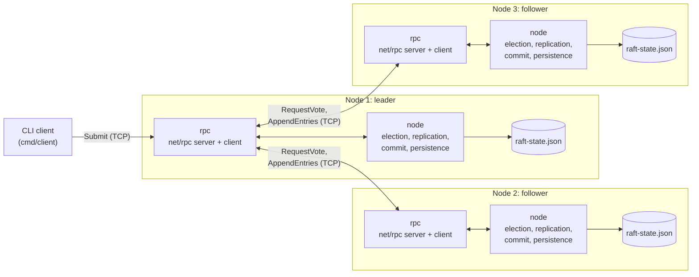
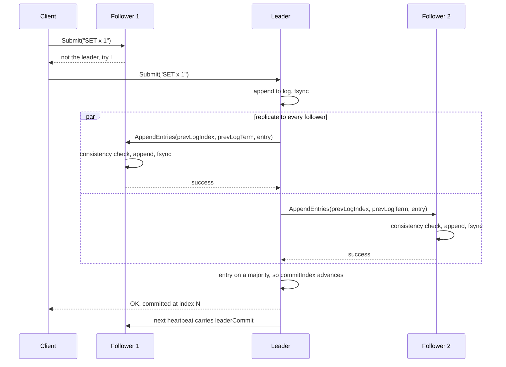

# raft-kv

A from-scratch implementation of the **Raft consensus algorithm** in Go: leader election, log replication, majority commit and crash-safe persistence, with every node running as its own OS process and talking to the others over TCP.

It's a learning and portfolio project, not a production database. What makes it more than a toy is how it's tested: real multi-process clusters are killed, partitioned and restarted, and the tests check Raft's safety guarantees after every scenario. [Known Limitations](#known-limitations) lists, just as plainly, what it does not do.

> **Name vs. scope:** commands are replicated and committed, but no state machine applies them yet. The key-value layer that would give the project its name (`SET`/`GET` on top of the log) is the next step on the [roadmap](#roadmap).

---

## What it does

- **Leader election** with randomized timeouts, one vote per term, and the §5.4.1 rule that only a candidate with an up-to-date log can win, so a leader always holds every committed entry.
- **Log replication** with the §5.3 consistency check, conflict truncation, and **term-based backtracking**: a follower whose log diverged catches up in a few round trips instead of one per entry.
- **Majority commit**, including the **Figure 8 rule** (a leader only commits entries from its own term by counting replicas), plus a **no-op entry** on every new leadership so entries left over from earlier terms commit promptly.
- **Crash-safe persistence**: term, vote and log are written atomically (temp file, fsync, rename, directory fsync) **before** any RPC reply, so a restarted node never forgets a vote or an acknowledged entry. Corrupted state files are detected and refused at startup.
- **CLI client** that finds the leader through follower redirects and reports each write as committed, not applied, or unknown.
- **Structured logging** (`log/slog`, text or JSON) of every state transition, which the tests merge into one cross-process timeline.

---

## Architecture

Each node is a separate process (`cmd/main.go`). All of the Raft logic lives in the `node` package, which knows nothing about networking: it takes and returns plain Go values. The `rpc` package is a thin adapter between that logic and Go's `net/rpc` over TCP.



A client can send its write to any node: a follower rejects it with a hint naming the leader, and the client retries there. Inside each process, the `node` package reaches the network only through a small `Transport` interface (`node/transport.go`). That keeps an import cycle out (the `rpc` package already imports `node`), and lets unit tests run whole clusters in memory, with the real leader code talking directly to the real follower code.

### The life of a write



The leader answers the client only once the entry is committed, and it checks that the committed slot still holds *this* entry. If a leader change overwrote it, the client is told the outcome is unknown rather than given a false "OK".

---

## Repository layout

```
├── cmd/
│   ├── main.go          # node binary: one Raft node per process
│   └── client/main.go   # CLI client: SET <key> <value>
├── node/                # all Raft logic (no networking)
│   ├── election.go      # election timer
│   ├── campaign.go      # candidate side of elections, becoming leader
│   ├── vote.go          # RequestVote receiver
│   ├── append.go        # AppendEntries receiver (Figure 2 rules)
│   ├── heartbeat.go     # leader's replication loop and backtracking
│   ├── commit.go        # majority commit with the Figure 8 rule
│   ├── submit.go        # client commands, waiting for commit
│   ├── storage.go       # atomic, validated persistence
│   ├── state.go         # state transitions and log helpers
│   └── *_test.go        # unit tests, incl. in-memory clusters
├── rpc/                 # net/rpc messages, server adapter, client transport
└── test/                # process-level tests: real clusters, real failures
```

---

## Getting started

Requires **Go 1.24+**. No external dependencies.

```bash
go build ./...
```

### Run a 3-node cluster

Start each node in its own terminal (the same commands work in PowerShell):

```bash
go run ./cmd -id=1 -addr=127.0.0.1:9001 -peers="2=127.0.0.1:9002,3=127.0.0.1:9003" -data-dir=data/node1
go run ./cmd -id=2 -addr=127.0.0.1:9002 -peers="1=127.0.0.1:9001,3=127.0.0.1:9003" -data-dir=data/node2
go run ./cmd -id=3 -addr=127.0.0.1:9003 -peers="1=127.0.0.1:9001,2=127.0.0.1:9002" -data-dir=data/node3
```

Within about a second, one node logs `became leader`, and every node prints a status line once a second:

```
level=INFO msg=status node=2 state=Leader term=1 log=1 commit=1 leader=2
```

### Send writes

```bash
go run ./cmd/client -cluster="1=127.0.0.1:9001,2=127.0.0.1:9002,3=127.0.0.1:9003" SET x 1
# OK: committed at index 2 (term 1) by leader node 2
```

Now stop the leader with Ctrl+C and send another write: the client finds the new leader by itself. Stop and restart any node with the same `-data-dir`, and it comes back with its term, vote and log intact.

### Node flags

| Flag | Default | Meaning |
|---|---|---|
| `-id` | | This node's unique numeric id |
| `-addr` | | Address to listen on, e.g. `127.0.0.1:9001` |
| `-peers` | | Every other node, as `id=address` pairs |
| `-data-dir` | *(in memory)* | Where to persist term, vote and log; one directory per node |
| `-election-timeout` | 150ms in memory, 500ms with `-data-dir` | Minimum election timeout; each timeout is random in [t, 2t) |
| `-log-format` | `text` | `text` or `json` |
| `-log-level` | `info` | `debug`, `info`, `warn` or `error` |
| `-test-save-delay` | 0 | Testing only: make every save slower, to simulate a slow disk |

---

## Testing

```bash
go test ./...            # everything (about a minute: the process-level tests start real clusters)
go test ./... -short     # unit tests only
go test -race ./...      # with the race detector
```

There are over 80 automated tests, passing on Linux and Windows and clean under the race detector.

**Unit tests (`node/`)** cover each rule of the Raft paper's Figure 2 in isolation and on in-memory clusters. Among them: the up-to-date log restriction, the Figure 8 commit scenario, majority thresholds on 3, 4 and 5 nodes, the six divergent followers of Figure 7 (each converges within 3 round trips), and a test that drives a node through every state-changing path and fails if any change is left unsaved before a reply.

**Process-level tests (`test/`)** build the real binaries and run 3- and 5-node clusters as separate processes:

| Scenario | What must hold |
|---|---|
| Kill the leader | The survivors elect a new leader in a higher term |
| 10 writes through the CLI client | All nodes end with identical logs, entry by entry |
| A follower crashes mid-stream and comes back | Writes keep committing; it catches up to the same log |
| Partition the leader away | The majority elects a new leader; the isolated one can't commit |
| Heal that partition | The old leader steps down and discards its uncommitted write |
| Kill 2 of 5 nodes, then a 3rd | Writes continue with 3 of 5, stop with 2 of 5 |
| Restart a node while it's partitioned | Its log, term and vote come back from its own disk |
| Kill and restart the whole cluster | Committed writes survive; new writes land after them |
| Every save takes 150ms longer | No spurious elections, leader unchanged |

Two pieces of test infrastructure make these possible:

- **Network partitions without touching the code under test.** In these tests nodes reach each other through a per-link TCP proxy (`test/netproxy_test.go`) that can cut any link, so a partition is a real network failure from the nodes' point of view.
- **Safety checked from the logs.** Every process-level test parses all nodes' JSON logs at the end and fails if two nodes ever claimed leadership of the same term (the paper's Election Safety property). When a test fails, it prints all nodes' logs merged into one time-ordered timeline.

Each of these tests was also run against a deliberately broken implementation (no majority check, no conflict truncation, no persistence...) to make sure it fails when the property it covers is violated.

---

## Design decisions

- **`net/rpc` instead of gRPC.** Zero dependencies and the same choice as MIT 6.824's labs. The trade-off is no streaming, no built-in deadlines and no schema; the client side adds its own timeouts.
- **One node per process.** "Kill the leader" is a real `kill`, and every test exercises real sockets, serialization and process restarts.
- **Persist before replying, with one fsync per RPC.** Figure 2 requires the state to be durable before a node answers. An RPC that changes several things (say, adopting a term and granting a vote) saves them together.
- **Election timeout depends on the disk.** The paper requires broadcast time, *including fsync*, to be much shorter than the election timeout. 150-300ms is right in memory; with persistence the default is 500-1000ms, the same trade-off etcd makes.
- **A polling election timer** rather than `time.Timer.Reset`, which has well-known races. One long-lived goroutine per node compares the time since the last reset against a randomized timeout.

### Bugs that only real clusters revealed

- **Followers losing their election timer.** A follower whose term advanced by *voting* (rather than by campaigning) was left with no timer at all, and would never notice a dead leader. Found the first time three real processes ran together.
- **Slow recovery after a restart.** A follower that came back with an empty log was walked back one entry per round, because the leader trusted a stale `matchIndex`. The leader now believes the follower's own report and jumps there directly.
- **Stalls on a slow disk (Windows).** A full-restart test failed only on Windows. The merged timeline showed a slow save making followers think the leader had died, and an in-flight write left uncommitted after the leader change. Reproducing it on Linux with `-test-save-delay` showed that with 150ms saves the cluster could not elect a leader at all: a vote took longer than the timeout. The fix was the no-op entry, disk-aware timeouts and one fsync per RPC.

---

## Known limitations

Documented deliberately: knowing a system's edges matters as much as building it.

- **No state machine yet.** Commands are replicated and committed but never applied, so there is no read path (`GET`). See the [roadmap](#roadmap).
- **No log compaction or snapshots.** The log grows forever, and every save rewrites the whole state, so a save costs O(log size). Real systems append to a write-ahead log and compact it with snapshots.
- **Disk writes happen under the node's lock.** While a save is in progress the node does nothing else: a leader sends no heartbeats. A long disk stall can therefore trigger an election, which was observed once on Windows (a stall of about 3 seconds). Saves slower than 100ms are logged as `slow disk write`. etcd avoids this by persisting outside the main lock, which is left as future work.
- **No PreVote.** A node cut off from the cluster keeps incrementing its term, and when it returns it forces an unnecessary election (Raft thesis, §9.6).
- **No CheckQuorum or leader leases.** An isolated leader doesn't know it has been deposed and keeps accepting writes it can never commit; clients get an "unknown" outcome for them.
- **At-least-once client semantics.** The client never retries an "unknown" write by itself, but a person retrying by hand could apply it twice. Exactly-once needs request IDs deduplicated by the state machine.
- **No membership changes.** The set of nodes is fixed at startup.
- **One new TCP connection per RPC**, and no TLS or authentication. The cluster is meant for one machine or a trusted network, and handles crash faults and network partitions, not Byzantine ones.

---

## Roadmap

1. **Key-value state machine**: apply committed entries (skipping no-ops) to an in-memory map, and add `GET`.
2. **End-to-end test**: `SET` on the leader, kill it, `GET` the value from the new leader.
3. Possible next steps after that: snapshots, PreVote, persisting outside the node lock.

---

## References

- Diego Ongaro and John Ousterhout, [*In Search of an Understandable Consensus Algorithm (Extended Version)*](https://raft.github.io/raft.pdf), 2014: the Raft paper. Figures 2, 7 and 8 are referenced throughout the code.
- Diego Ongaro, [*Consensus: Bridging Theory and Practice*](https://github.com/ongardie/dissertation), PhD thesis, 2014 (PreVote, §9.6).
- Jon Gjengset, [*Students' Guide to Raft*](https://thesquareplanet.com/blog/students-guide-to-raft/) (MIT 6.824).
- etcd documentation, [*Tuning*](https://etcd.io/docs/latest/tuning/): heartbeat and election timeouts relative to disk latency.

---

## Author

**Pablo Jorda Beltrán**, Computer Engineering student (Computing & AI), Universitat Politècnica de València.
GitHub: [@pablojordab](https://github.com/pablojordab)